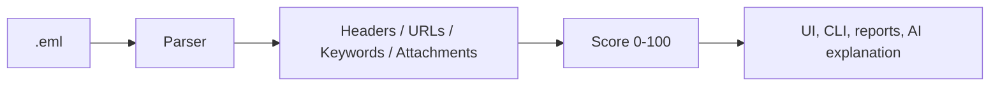

# Phishing Email Analyzer

Upload a suspicious email (`.eml`) and get a **0–100 risk score**, the **red flags** behind it, and a
**plain-English explanation** from a local AI model (Ollama), with an offline fallback.



## What it checks

- **Links:** look-alike domains (`paypa1`), link text that hides the real destination, raw IPs, shorteners, punycode
- **Sender:** SPF / DKIM / DMARC results, Reply-To and Return-Path mismatches, fake brand display names
- **Wording:** urgency, threats, password requests, money lures, generic greetings
- **Attachments:** executables, double extensions (`invoice.pdf.exe`), macro files, archives (never opened)

## Quick start

```bash
pip install -r requirements.txt
```

```bash
streamlit run app.py
```

```bash
python cli.py samples/phishing_paypal.eml
```

```bash
python -m pytest
```

**Optional AI explanation:** install [Ollama](https://ollama.com), then run `ollama pull llama3.2`.
Without it, the app uses a built-in template.

## Safety

- The AI only sees the findings, never the email body, so the email can't inject instructions into the model.
- Attachments are never opened, and email HTML is never rendered. Links are shown defanged (`hxxp://evil[.]example`).
- Everything runs offline. Handle real phishing samples inside an isolated VM.

## More

- [How it works](docs/architecture.md)
- [Sample emails and test cases](docs/test-cases.md)
- [Threat model, limitations and safe lab setup](docs/threat-model.md)
